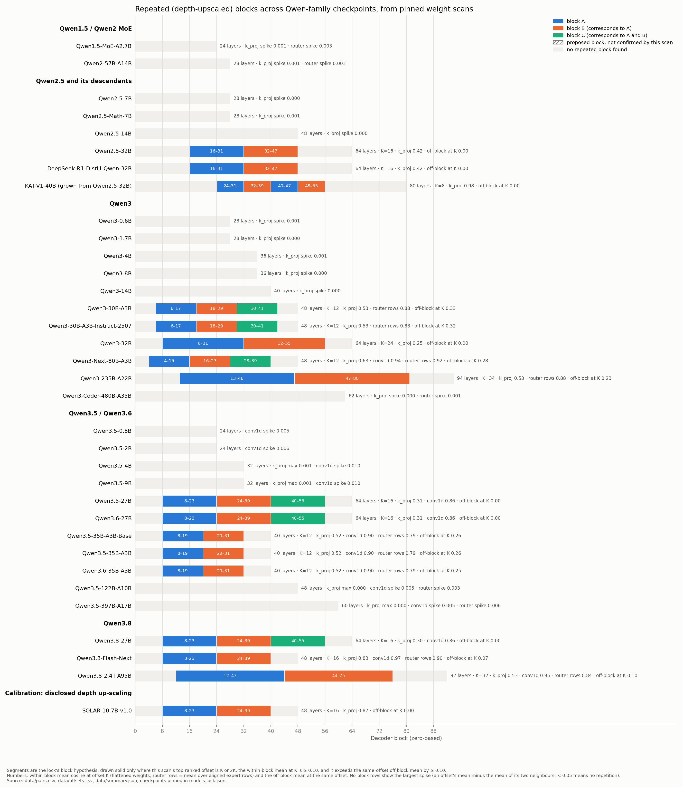

> Lightweight GitHub mirror of [HF v0.2.1](https://huggingface.co/datasets/ec75hash/copy-blocks-qwen/tree/a4aeff1c9ed627ec45474e917fa5ce47af43e864). Large response arrays and raw recordings remain on the Hub; see [mirror contents](MIRROR.md).

# Repeated blocks in Qwen-family checkpoints: pinned weights and neuron responses

[v0.2.1 packaging note](docs/PATCH_V021.md): checksum metadata corrected; measurements unchanged.

## New in v0.2.0, part 1: the 14B/32B weight maps

**Qwen2.5-32B and Qwen3-32B each show an ordered layer-by-layer match to their
14B counterpart, with a middle block matching at two consecutive positions in
the 32B.** These maps are consistent with expansion from 14B-sized models by block
duplication, a construction method disclosed for SOLAR and KAT. The layer maps
are measured directly between pinned checkpoints (fixed commits of the model repositories), with additional neuron/head
measurements for Qwen3.

| Family | Decoder layers, 14B → 32B | Measured repeated range inside the 32B | MLP width, 14B → 32B | Findings |
|---|---:|---|---:|---|
| Qwen2.5 | 48 → 64 | 16–31 ↔ 32–47 | 13,824 → 27,648 | [Cross-checkpoint keys, biases and norms](studies/qwen25_weights/README.md) |
| Qwen3 | 40 → 64 | 8–31 ↔ 32–55 | 17,408 → 25,600 | [MLP weights, cross-checkpoint gate rows and head maps](studies/qwen3_weights/README.md) |

For Qwen2.5, the 14B's layers 16–31 match **both** consecutive 32B blocks:
mean key-weight cosine 0.485 and 0.738, and query-bias cosine 0.993 and 0.998.
The maximum absolute key cosine off that map is 0.004315. The 14B's layers
0–15 match 32B layers 0–15, and its layers 32–47 match 32B layers 48–63.

For Qwen3, the first 17,408 gate-neuron indices show substantial correspondence
with the 14B's, and the 8,192 higher-index channels have a structured relationship
to leading channels. Early-layer exceptions and sampled head-map exceptions
are retained in the results.

Two measurements are reported for Qwen3. **Inside Qwen3-32B**, layers 32–55
match layers 8–31. **Between checkpoints**, 14B layers 0–9 match 32B layers
0–9 best, while 14B layers 10–39 match 32B layers 34–63 best (an offset of 24).
For 14B layers 8 and 9 the first-position block is closer; from layer 10 onward
the second-position block is closer. These comparisons describe different maps.

Expansion is the interpretation of these measured maps. The released checkpoints
do not determine which checkpoint came first or when a construction step occurred.
The Qwen2.5 MLP width is known to double; its channel-by-channel widening procedure
has not yet been measured.

See the [short glossary](docs/GLOSSARY.md) for the measurement terms used here.

## New in v0.2.0, part 2: do the corresponding neurons respond alike?

This is a separate measurement on a different artifact: activations of the official
Qwen3-32B Q8 GGUF checkpoint on a fixed text corpus, not the stored BF16 weights compared
above. It asks only how alike same-index neurons 24 layers apart respond. It makes no
claim about the weight maps and does not establish a shared function.

In that study (one Apple M5 Max, 48 GB, llama.cpp with Metal; about two hours),
same-index partners rank first of
101 candidates in **185/288** sampled pairs. The typical resemblance is small:
median final-activation correlation **0.0555**, median overlap **4 of the top 100**
windows and **0 of the top 10**. [Response results and full evidence](studies/qwen3_response/README.md).

### Where to start

| Study | Included evidence | Start here |
|---|---|---|
| Qwen2.5-14B ↔ 32B weights | Six 48×64 cosine matrices, all 18,432 pair values, original capture, pinned tensor hashes and CPU reproduction | [Qwen2.5 findings](studies/qwen25_weights/README.md) |
| Qwen3-32B MLP and Qwen3-14B ↔ 32B weights | All-pair MLP measurements, K/V maps, aligned gate rows, higher-index-channel and head checks | [Qwen3 findings](studies/qwen3_weights/README.md) |
| Qwen3-32B Q8 responses | All 288 sampled pairs, 10,000 fixed windows, full retained measurements and 512 raw paired-channel windows | [Response findings](studies/qwen3_response/README.md) |
| Original 34-checkpoint survey | Original within-checkpoint K/V, router and convolution tables, scanner and figures | [Survey results](RESULTS.md) |

**Read the tables and plots online without downloading the large arrays.**
The two weight studies' offline table checks need under 50 MB of study files,
plus Python dependencies. Fresh tensor remeasurement is a separate download.
Reading the response tables is also lightweight, but re-deriving them needs
the retained capture files, about 3.5 GB (3.3 GiB). No model weights are bundled.
It uses the official Q8 GGUF checkpoint (Qwen’s published 8-bit quantization),
separately pinned from the BF16 weight scans.
The corpus has 10,000 distinct windows; an article-title parser defect is
[documented separately](studies/qwen3_response/CORPUS_LABEL_CORRECTION.json).

[Changes and scope](docs/UPDATE_20261027.md) · [Reproduction](docs/REPRODUCTION_V020.md)

## Original weight survey

The following survey and its root `data/` tables retain the v0.1.2 measurements.
The new studies are stored separately under `studies/`; the survey counts are not expanded
by treating cross-checkpoint pairs or activation samples as additional checkpoints.

**Several Qwen checkpoints contain a stretch of decoder blocks whose weights are far more similar,
block for block, to the stretch a fixed offset away than any other pair of blocks at that offset:
layers 32–55 of Qwen3-32B line up with layers 8–31, layers 20–31 of
Qwen3.5/3.6-35B-A3B line up with 8–19, layers 32–47 of Qwen2.5-32B line up with 16–31, and so on
across the surveyed checkpoints.** Corresponding pairs show elevated cosine relative to
the other pairs at the same offset. Routers also have a nonzero background, and some checkpoints
have additional structure at other offsets. SOLAR-10.7B provides a disclosed depth-upscaling
comparison in the same tensor family. This release measures that pattern in 34 pinned checkpoints with nothing but HTTP byte-range
reads of their public weight files, and ships the data, the scanner and a verifier so anyone can
check it on a laptop. For survey counting, grouping related variants and derivatives gives
**16 Qwen or Qwen-derived checkpoints with a block (about 9 groups of related checkpoints)**
and **17 without (16 grouped rows)**, plus SOLAR as a separate
calibration. The grouped positive rows are Qwen3.5-35B Base/Instruct with Qwen3.6-35B,
Qwen3.5/3.6/3.8-27B, Qwen3-30B with its 2507 variant, and Qwen2.5-32B with R1 and KAT;
the negative rows group Qwen2.5-7B with Math-7B. Every checkpoint is measured separately.

Jeffrey Shorthill · independent interpretability research · 2026-10-27 · v0.2.1



## Six survey rows at a glance

Within-block mean cosine between corresponding layers, with the mean over the remaining
pairs at the same offset for comparison. Both are flattened float64 cosines except the
explicitly labeled router-row values, which use aligned per-row cosines for both means. Full table: [RESULTS.md](RESULTS.md).

| Checkpoint | Layers | Corresponding blocks | Tensor | Within-block | Same-offset, off-block |
|---|---:|---|---|---:|---:|
| Qwen3-32B | 64 | 8–31 ↔ 32–55 | attention k_proj / v_proj | 0.254 (n=24) / 0.447 (n=24) | 0.000 (n=16) / 0.000 (n=16) |
| Qwen3.6-35B-A3B (Qwen3.5-35B-A3B and its Base within 0.002) | 40 | 8–19 ↔ 20–31 | DeltaNet conv1d / k_proj / router rows | 0.896 (n=9) / 0.524 (n=3) / 0.795 (n=12) | -0.001 (n=12) / 0.000 (n=4) / 0.260 (n=16) |
| Qwen2.5-32B (and DeepSeek-R1-Distill-Qwen-32B) | 64 | 16–31 ↔ 32–47 | attention k_proj; v_proj (2.5-32B only) | 0.424 / 0.422 (n=16 each); v_proj 0.544 (n=16) | 0.000 (n=32 each); v_proj 0.000 (n=32) |
| Qwen3.6-27B (3.5/3.8 measured separately; values here are 3.6) | 64 | 8–23 ↔ 24–39 ↔ 40–55 | DeltaNet conv1d / k_proj | 0.859 (n=24) / 0.309 (n=8) | 0.001 (n=12) / 0.000 (n=4) |
| SOLAR-10.7B-v1.0 (disclosed up-scaling, calibration) | 48 | 8–23 ↔ 24–39 | attention k_proj | 0.871 (n=16) | 0.000 (n=16) |
| KAT-V1-40B (Qwen2.5-32B expanded, per its report) | 80 | 24–31 ↔ 32–39 and 40–47 ↔ 48–55 | attention k_proj | 0.984 / 0.978 (n=8 each; 16 total) | 0.000 (n=56) |

Counts refer to the displayed means. In the [full verdict table](RESULTS.md),
“confirmed” means passing the reporting rule for the declared pattern, not a demonstrated training history. The 27B row pools the two consecutive block comparisons:
12 convolution pairs and 4 attention pairs per comparison. KAT displays its two separate
8-pair means separately; Qwen2.5-32B, its R1 derivative, and SOLAR contribute 16 pairs
per 16-layer segment comparison.
The value projection (`v_proj`) was added for Qwen3-32B and Qwen2.5-32B
on 2026-10-21 as a second attention tensor family. Measured against its own same-offset
background, it shows elevated similarity at the same corresponding positions as the key
projection (within-block 0.447 and 0.544, off-block 0.000, offset spectrum peaking only at K, the declared block spacing),
and in both checkpoints, corresponding value projections have higher within-block cosine
similarity than corresponding key projections. Keys and values are trained together, so this
corroborates rather than independently replicates the key-projection result; the query and output projections and the
MLP are outside this original survey table. The v0.2.0 Qwen3-32B MLP and cross-checkpoint measurements are reported in the separate weight study linked above.

Under the inherited-block interpretation, KAT also predicts offsets 16+8=24 and
16+2×8=32; the four observed 8-pair correspondences are listed in
[RESULTS.md](RESULTS.md#kat-inherited-block-arithmetic).

Across the surveyed MoEs, flattened router means at offset 1 round to 0.26–0.51.
The table and chart compare within-block similarity against the same-offset off-block
background; the raw-rank reporting rule's margins are reported in [RESULTS.md](RESULTS.md#router-raw-rank-gate-margins). The checkpoints with no repeat
(every model at or below 14B, Qwen3.5-122B and 397B, Qwen3-Coder-480B, Qwen1.5/2 MoEs) show no
eligible neighboring-offset spike above 0.010175
under the [reporting rules](METHODS.md#offsets-regions-and-periods). Two small-hybrid attention families
have no offset with six pairs and remain explicitly unranked; their convolution families
support the model-level no-block result.

## Check it yourself

The full-package check below expects the complete snapshot, including the response archive.
For small weight-only downloads and reductions, use [the selective route](docs/REPRODUCTION_V020.md#weight-studies-only).

Offline, allow a few minutes on an SSD, no network: verifies every file hash, the lock and scanner hashes, the
block coverage against each pinned `config.json`, and that `RESULTS.md` regenerates byte for byte.

```bash
git lfs install
git clone https://huggingface.co/datasets/ec75hash/copy-blocks-qwen
cd copy-blocks-qwen
python3 -m venv .venv && source .venv/bin/activate && pip install -r requirements.txt
python -m unittest discover -s tests
python scripts/verify_release.py
python scripts/make_report.py --out /tmp/figs --report /tmp/RESULTS.md
```

Online, the real test: re-read the pinned tensors from the Hub and recompute everything. The
scanner downloads only `config.json`, the safetensors index (or header) and the selected tensors'
byte ranges; it refuses any response that is not an honoured `Range` request. No model runs.
No GPU. This example selects Qwen3-32B, Qwen3.6-35B-A3B, Qwen2.5-32B and the SOLAR
calibration (about 3.2 GB of tensor payloads, including `k_proj` and `v_proj`
for the two dense checkpoints):

```bash
python scripts/scan_weights.py --models qwen3-32b qwen36-35b-a3b qwen25-32b solar-10p7b \
    --out reproduction/data --provenance reproduction/metadata
python scripts/make_report.py --data reproduction/data --out reproduction/figures --report reproduction/RESULTS.md
python - <<'PY'
import csv, math
selected = {"Qwen/Qwen3-32B", "Qwen/Qwen3.6-35B-A3B",
            "Qwen/Qwen2.5-32B", "upstage/SOLAR-10.7B-v1.0"}
def read(path):
    with open(path) as f:
        rows = [r for r in csv.DictReader(f) if r["model"] in selected]
    pairs = {(r["model"], r["revision"], r["tensor"], r["layer_a"], r["layer_b"]):
             float(r["cosine"]) for r in rows}
    assert len(pairs) == len(rows), "duplicate pairs"
    return pairs
a, b = read("data/pairs.csv"), read("reproduction/data/pairs.csv")
assert a.keys() == b.keys(), "missing or extra pairs"
assert all(math.isfinite(b[k]) and abs(a[k] - b[k]) <= 1e-9 for k in a)
print("Matched", len(a), "pairs within 1e-9")
PY
```

The original survey covers 34 checkpoints and 2,464 tensors (11.1 GB of tensor payloads).
The original v0.1.0 capture covered 2,336 tensors (9.8 GB); its recompute from the
local cache took 13 minutes. The v0.1.1 extension
adds 128 value-projection tensors (1.34 GB). Hardware used here:
Apple M5 Max, 48 GB, macOS 27.0.1, Python 3.14.4, NumPy 2.4.2 (Accelerate BLAS). The largest normalized input stack is 80 × 5,242,880 values in float64 (3.36 GB);
peak memory is higher because decoded weights, stacked copies and conversion temporaries
coexist. The complete survey was run with 48 GB of RAM.

## Independent reproduction

A second scanner, written separately in a Codex (GPT-6) session with its own tensor cache and
its own pair table, measured 33 of these checkpoints at the same revisions; its roster omitted
DeepSeek-R1-Distill-Qwen-32B. All 38,540 layer
pairs the two tables share agree to within 4 × 10⁻¹⁵, and all 1,552 shared tensor payload hashes
match. Details in [docs/INDEPENDENT_CHECK.md](docs/INDEPENDENT_CHECK.md). That comparison also
caught a real bug: on this platform a float32 Gram matrix of 32 or more multi-million-element
rows is wrong by about 0.005 (normalised diagonals come out 0.99). Both scanners now accumulate in
float64, with diagonal tolerances of 10⁻⁹ here and 10⁻¹⁰ in the independent scan. The
largest correction in the earlier Qwen3.6-27B release is SOLAR's within-block mean,
0.870722 → 0.871450; the smaller 27B changes are listed in the independent-check note.

## Limitations and notes

The within-block similarity in the table above, measured against the same-offset background and the
surveyed controls, is consistent with the paired blocks having started from the same weights, as in the
two disclosed depth up-scalings in the table (SOLAR, KAT). Weights alone do not show how or when a model
was built, how much training followed any copy, or whether paired blocks now compute the same function.
Cosine is not a clock.

- The original survey is weights only. The Q8 response study adds measured activations under its own
  scope, without a same-feature or causal-function verdict.
- Shared initialisation is the reading, not a recipe. Qwen has not published how these checkpoints were
  built. In the original survey the reading "copied, then trained" rests on the SOLAR calibration and the
  off-block floor; for Qwen2.5-32B and Qwen3-32B the v0.2.0 cross-checkpoint studies add a trained
  external reference.
- One tensor family per claim (two, `k_proj` and `v_proj`, for Qwen3-32B and Qwen2.5-32B). Dense models
  are read through `k_proj`; hybrids add the DeltaNet `conv1d`; MoEs add the router. Other tensors may
  tell a more or less similar story.
- Routers have a non-zero baseline between any two layers, so their numbers are only meaningful against
  the same-offset off-block value printed beside them.
- No confidence intervals: rows within a checkpoint share weights and are not independent samples. The
  measurement is deterministic; the same bytes give the same numbers.
- Pinned revisions only (`models.lock.json`). `Qwen3-Next-80B-A3B` and `Qwen3-Coder-480B-A35B` are read
  from their Instruct repositories because no base checkpoint is published.
- KAT-V1-40B's Hub index names the wrong shard for 76 of its 80 `k_proj` tensors; the scanner resolves
  tensors against the shard headers and records the mismatch in `data/provenance.json`.

## Original survey files and provenance

The Hub dataset is the canonical versioned release. The
[GitHub repository](https://github.com/ec75hash/copy-blocks-qwen) mirrors code and
documentation with the two small weight studies, without the large response arrays.

- `models.lock.json`: 34 checkpoints, full commit SHAs, SHA-256 of each `config.json` and index,
  tensor families, and the block hypothesis (period and region, or explicit segments) per row.
  Its `note` fields are historical working annotations: “chart” refers to the September 2026
  survey chart described in [chart corrections](docs/CHART_CORRECTIONS.md); the remaining
  notes describe controls, variants and checkpoint selection. These notes are not measurement inputs.
- `data/pairs.csv`: 60,982 layer pairs: model, revision, tensor, layer_a, layer_b, offset,
  cosine, row-mean cosine, whether the pair is a corresponding-block pair.
  The historical `both_inside_region` field marks aligned-pair membership here;
  [column definitions](docs/SURVEY_COLUMNS.md) explain this and the other fields.
- `data/offsets.csv`, `data/summary.json`: per-offset means and the per-family summaries.
  The summary's `inside_row_mean` and `outside_row_mean` provide the matched row-mean
  comparison shown in RESULTS and the README router row (0.795 versus 0.260 for Qwen3.6-35B).
- `data/provenance.json`: every tensor's shard, dtype, shape, absolute byte range, payload and
  header SHA-256, plus scanner and lock hashes, package versions and run time.
  Capture-time hashes are retained alongside recorded reporting amendments; the added
  off-block row means were aggregated from the saved pair table without a new weight scan.
- `provenance/metadata/`: the pinned `config.json` and index files (no tensor data).
- `checksums.json`: SHA-256 of every released file except the manifest itself; `scripts/verify_release.py` checks it.
- `figures/`: the family chart, offset spectra for the 37 confirmed families, and six heat maps.
- [METHODS.md](METHODS.md) · [RESULTS.md](RESULTS.md) · [docs/CHART_CORRECTIONS.md](docs/CHART_CORRECTIONS.md)
  (what changed against the author's earlier hand-assembled chart) · [NOTICE](NOTICE) · [CITATION.cff](CITATION.cff)

Earlier related release: Qwen3.6-27B weight and readout measurements,
https://github.com/ec75hash/qwen-depth-upscaling-jpp-check.

Code Apache-2.0 ([LICENSE](LICENSE)); original derived data, figures and prose CC BY 4.0 ([LICENSE-DATA.md](LICENSE-DATA.md)). WikiText-derived excerpts retain their [upstream declarations and attribution](studies/qwen3_response/corpus/NOTICE.md).
The scanner derives from the 27B release; Claude assisted with its extensions, the report code
and this documentation; the independent check was a Codex session. The survey, its direction and
its interpretation are the author's.
