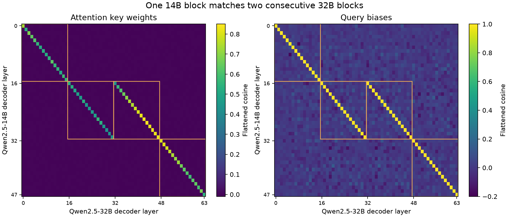

# Qwen2.5-14B / 32B: one block appears twice

Measured October 27, 2026; recomputed offline from the same cached payloads in a separate Codex-assisted session. All layer indices are zero-based.
See the [glossary](../../docs/GLOSSARY.md) and [column definitions](COLUMNS.md).

**Qwen2.5-14B's layers 16–31 match two consecutive blocks in Qwen2.5-32B,
at layers 16–31 and 32–47, including their trained attention biases.** Its
layers 0–15 match 32B layers 0–15, and its layers 32–47 match 32B layers 48–63.
This is consistent with expansion from a 14B-sized model by block duplication.
The MLP width doubles in the configs; how its channels were populated remains
unmeasured.

| Qwen2.5-14B layers | Qwen2.5-32B layers | Mean key-weight cosine | Mean query-bias cosine |
|---|---|---:|---:|
| 0–15 | 0–15 | 0.580718 | 0.995877 |
| 16–31 | 16–31 | 0.484755 | 0.993225 |
| 16–31 | 32–47 | 0.738111 | 0.997633 |
| 32–47 | 48–63 | 0.683175 | 0.998167 |

Twin A means 32B layers 16–31 and twin B means 32B layers 32–47, both
compared with 14B layers 16–31; the names carry no chronology. In the pair
table, `prefix` maps 14B 0–15 to 32B 0–15, `suffix` maps 14B 32–47 to 32B
48–63, and a blank `map_group` denotes an off-map pair.

Every 14B layer's strongest key-weight match is at an expected mapped position.
For every layer 16–31, the two mapped 32B layers are its two strongest matches.
The largest absolute key cosine outside the specified map is **0.004315**;
the mean signed off-map cosine is **−0.000012702**.



## What was compared

The six families are full attention key matrices, query/key/value biases, and
the two RMSNorm gain vectors. Each family compares all 48 source layers against
all 64 target layers: **18,432 cross-checkpoint cosine values** in total.
Norm gains are compared after subtracting their stored all-ones initialization.

The key and layer-specific bias patterns locate the map. Norm profiles have a
high similarity background even away from it; their similarity alone is less
specific. Value biases are less alike than query biases: their twin-A/B mapped
means are 0.653286 and 0.946377. Full six-family values and ranges are in the
[generated results](RESULTS.md) and [pair table](analysis/cross_checkpoint_pairs.csv).

The specified map contains 64 pairs. The other 3,008 pairs per family form the
off-map background. These are cross-checkpoint comparisons, kept separate from
the original within-checkpoint survey and its checkpoint counts.

## Architecture and interpretation

Both models have hidden width 5,120, 40 query heads and 8 KV heads. Decoder depth
changes from 48 to 64; MLP width changes from 13,824 to 27,648. The 16-layer
insertion and the doubled MLP width make expansion a concrete explanation of
the measured correspondence. How the MLP channels were populated has not yet
been measured for this pair.

The measurements show related learned weights. They do not establish
which released checkpoint came first or exclude a common trained ancestor.
The Qwen2.5 report does not describe this cross-size construction relationship
in its architecture/pretraining account; its architecture table lists the two
sizes and its data description reports the 18-trillion-token dataset.
[Qwen2.5 report, §§1–3](https://arxiv.org/html/2412.15115v2).

For a documented example of the general method, KAT explicitly describes growing
Qwen2.5-32B through selected-layer duplication and continued training.
[KAT-V1 report, §2](https://arxiv.org/html/2507.08297v3#S2).
The present cosines do not measure when an expansion happened or how many tokens
of training followed it. Differences from the 14B endpoint are labeled reference
residuals, rather than assumed historical training updates.

## Corrections

On October 27, the maximum off-map key cosine was corrected from 0.003277328
to 0.004314988. The earlier code discarded two ranked targets in every row,
even where only one target belonged to the map; the corrected code excludes the
explicit mapped pairs. The six-family maxima, cause and affected files are in
[CORRECTIONS.md](CORRECTIONS.md). The mapped means and raw tensor values did not change.

## Data, pins and verification

- [Corrected original capture JSON](data/cross_qwen25_14b_32b.json) and
  [original code](code/as_run/cross_qwen25_14b_32b.py), retained byte for byte.
- [All six cross-cosine matrices](data/cross_cosines.npz), recomputed offline
  from the same cached BF16 payloads; [all pair values](analysis/cross_checkpoint_pairs.csv).
- [Mapped summaries](analysis/mapping_summary.csv), [off-map summaries](analysis/family_summary.csv)
  and [endpoint residuals](analysis/endpoint_residuals.csv).
- [Tensor provenance](provenance/tensors.json): 672 tensor names, shapes, byte
  ranges and payload hashes, from the original pinned captures. No model weights
  are redistributed in this study.
- [Same-cache recomputation](audit/independent_check.json): all 672 payload hashes matched
  both capture records; all 18,432 cosines and summaries reproduced, with maximum
  numerical discrepancy 2.44×10⁻¹³. No model inference or new weight download.

| Checkpoint | Pinned revision |
|---|---|
| Qwen/Qwen2.5-14B | `97e1e76335b7017d8f67c08a19d103c0504298c9` |
| Qwen/Qwen2.5-32B | `1818d35814b8319459f4bd55ed1ac8709630f003` |

## Reproduce

From the repository root, reduce and plot the released matrices and tables offline:

```bash
python studies/qwen25_weights/code/verify_and_plot.py --out reproduction/qwen25_weights_readout
```

This verifies the retained results without loading model weights. To remeasure
from an existing cache of the original pinned tensors, use:

```bash
python studies/qwen25_weights/code/reproduce_from_cache.py --cache /path/to/tensor-cache --out reproduction/qwen25_weights_capture
```

The portable entry point verifies every payload hash and computes float64 cosines;
its [path/verification changes](audit/portable_changes.json) are recorded separately
from the original code. It fails on a missing or changed cache file and does not
download anything.

An optional fresh cache can be populated with the original release scanner and
the study's explicit six-family lock. With no cache this reads **1,178,304,512 bytes
of selected tensor payloads**, plus config/index/shard-header metadata; it does not
fetch full model checkpoints. Metadata hashes and HTTP byte ranges are checked by
the scanner. Choose separate output directories:

```bash
python scripts/scan_weights.py --lock studies/qwen25_weights/provenance/scan.lock.json --cache /path/to/tensor-cache --out reproduction/qwen25_fresh_scan --provenance reproduction/qwen25_fresh_metadata
```

**That scan is a cache-filling step.** Its own `pairs.csv` is a within-checkpoint
comparison and uses raw norm gains, so it is not this study's result. Run
`reproduce_from_cache.py` as above to check all captures against the released
tensor hashes and rebuild the cross-checkpoint comparison, including norm
deviations from one. Fresh network remeasurement was not performed while preparing
this update.

### Check only the biases and norms: about 4 MB

The five small families total **560 payloads and 3,899,392 bytes**, plus metadata.
This route checks the near-0.99 query-bias correspondence without key matrices:

```bash
python scripts/scan_weights.py --lock studies/qwen25_weights/provenance/scan_small.lock.json --cache /path/to/small-tensor-cache --out reproduction/qwen25_small_scan --provenance reproduction/qwen25_small_metadata
python studies/qwen25_weights/code/reproduce_from_cache.py --small-only --cache /path/to/small-tensor-cache --out reproduction/qwen25_small_capture
```

The first command fills the cache; only the second produces the cross-checkpoint
statistic. It checks all five small families against the same recorded payload
hashes. Existing tensor caches work with either route.
