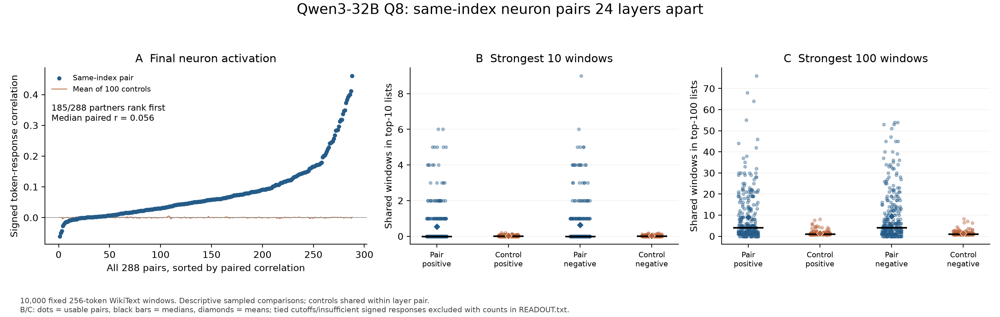

# Do same-index MLP neurons respond similarly 24 layers apart?

Collected October 26; exploratory readout October 27. Qwen3-32B official Q8_0 GGUF.
See the [glossary](../../docs/GLOSSARY.md) and [column definitions](COLUMNS.md).

**Same-index partners usually resemble one another more than the sampled random
controls do, but the resemblance is often weak.** The partner ranks first of 101
candidates in 185/288 cases; the median final-activation correlation is 0.0555.
The median pair shares four of its top 100 windows and zero of its top ten,
for both positive and negative response lists.



## Design and measurements

- Original decoder layers L=8…31 paired with L+24=32…55; 12 selected neurons per
  layer pair, 288 in total. Four are sampled from each of three neuron-index segments:
  A = 0–8191, B = 8192–17407, C = 17408–25599
  (see the [complete readout](READOUT.txt)).
  Equal segment sampling is not a population-weighted sample of all MLP neurons.
- 100 random different-index target neurons per layer pair, shared by its 12 source
  neurons and excluding the 12 true targets. Controls are not activity-matched. The historical selection record’s
  “pending” matched-control plan was not carried out; its run-state wording is
  retained as history, not a description of unfinished collection.
- 10,000 fixed 256-token WikiText-103 windows; 2,560,000 token observations per channel.
  Context resets per window; no chat template, BOS token or generated answer. One
  separate instrumentation window is excluded from the reported results.
- Main response is `SiLU(gate) * value`, the signed scalar before the down projection.
  Gate before SiLU and value were also retained; all four nonzero sign combinations
  were measured, including negative gate times negative value.
- Overall similarity is Pearson correlation at the same token positions. Passage
  overlap compares separately ranked positive and negative peak-response windows;
  a shared window can peak on different words in the two layers.

| Final activation comparison | Result |
|---|---:|
| Above the pair's mean random-control correlation | 264/288 |
| Partner ranks first among itself and 100 controls | 185/288 |
| Median paired correlation | 0.055526 |
| Median of per-pair control mean correlations | -0.000059 |

| Lists | Usable pairs | Mean shared, partners | Mean shared, controls | Median shared, partners |
|---|---:|---:|---:|---:|
| Positive top 10 | 283/288 | 0.537 | 0.020 | 0 |
| Negative top 10 | 284/288 | 0.627 | 0.020 | 0 |
| Positive top 100 | 283/288 | 9.011 | 1.309 | 4 |
| Negative top 100 | 285/288 | 9.537 | 1.283 | 4 |

These overlap exclusions are tied cutoffs, not silently broken ties. Each control
column averages that source pair's usable controls and then averages equally across
usable source pairs. The full top-10/100/500 and sign-specific rows, exclusion reasons
and usable-control counts are included in the CSV and readout.

## Examples and corpus correction

[Marked passage examples](analysis/PASSAGE_EXAMPLES.txt) show the highest positive
overlap, highest negative overlap, a near-median correlation and the lowest signed
correlation. Rules and underlying values are in [examples.json](analysis/examples.json).
These examples were selected after collection, not as an independent confirmation.
The highest positive-overlap pair shares 76 top-100 windows, but its source's four
equally strongest windows begin with the identical “In mathematics , the” context.
No broad concept label is assigned from that repeated phrase.

**The corpus parser sometimes mistook equation lines for article titles.** All
10,000 stored text windows are distinct, but independent-article sampling was not
achieved. Some windows start after false headings; an underlying article can
contribute multiple selected windows. Exact offending source rows and the condition
are in [CORPUS_LABEL_CORRECTION.json](CORPUS_LABEL_CORRECTION.json).
The frozen `inputs.json` and as-run preparation code retain their historical wording.
That wording is superseded by this correction. Neither input tokens nor measured
responses were silently changed after collection.

The post-hoc prefix-position check on the 512 raw windows gives median correlations
0.0494 with all positions, 0.0488 excluding the first eight response positions and
0.0500 excluding the first 32. Prefixes remain in the model inputs and raw controls
are unavailable, so this is not a causal prefix test or a new control comparison.

The files `selection/selection.json` and `data/capture/reports/summary.json`
retain historical setup/reporting status strings. Completion is established by
`data/capture/completion.json` and the capture checks. Path-only redactions to
capture metadata are listed in [amendments](../../docs/AMENDMENTS.json); captured
tokens, channels and response values are unchanged. The setup manifest no longer
lists an unavailable protocol draft; its selection and selection-script hashes
remain unchanged.

## Downloaded evidence

[data/capture/](https://huggingface.co/datasets/ec75hash/copy-blocks-qwen/tree/a4aeff1c9ed627ec45474e917fa5ce47af43e864/studies/qwen3_response/data/capture) contains the frozen exact text/token inputs, layout,
centered covariance checkpoint, per-window peaks/positions/sign counts/mean-RMS,
all 512 retained raw paired-channel windows, instrumentation, as-run code and reports.
It is roughly 3.5 GB (3.3 GiB), with no model weights or full source shard included.
The model is a separate 34.8 GB download only for fresh inference; it is unnecessary
for numerical reduction, checksums or plotting.

Model: [Qwen/Qwen3-32B-GGUF](https://huggingface.co/Qwen/Qwen3-32B-GGUF/tree/938a7432affaec9157f883a87164e2646ae17555),
revision `938a7432affaec9157f883a87164e2646ae17555`, file `Qwen3-32B-Q8_0.gguf`,
SHA-256 `2c50eb8aad05047dbf24fa014eb621adf552e14176cabe0c5db4ef38c91e2169`.
Dataset: [Salesforce/wikitext](https://huggingface.co/datasets/Salesforce/wikitext/tree/b08601e04326c79dfdd32d625aee71d232d685c3),
revision `b08601e04326c79dfdd32d625aee71d232d685c3`, first raw train parquet shard,
SHA-256 `74da360f23826045b3e6ac6375411fdb15f003030aa74f2596ed08b857cb9212`.
Text attribution and upstream license declarations are preserved in [corpus/](corpus/).

## Runtime

Collected on one Apple M5 Max with 48 GB of unified memory under macOS 27.0.1,
using llama-cpp-python 0.3.36 with the Metal backend, gguf 0.19.0, Python 3.14.4
and NumPy 2.5.4. The full pass over the 10,000 windows took about 1 hour
54 minutes. Runtime library hashes are recorded in
[data/capture/instrumentation.json](data/capture/instrumentation.json).

## Reproduce without running a model

From the repository root, with the root requirements installed:

```bash
python studies/qwen3_response/code/reduce_and_plot.py --out reproduction/qwen3_response
python studies/qwen3_response/code/verify_capture.py
```

The reducer recomputes all 864 correlation summaries, all 5,184 overlap
rows including exclusion/control counts, and the post-hoc raw-window prefix check.
The verifier checks every peak/sign/count/position and reduces 32 retained raw windows.
Output is outside the released data. No model inference or semantic interpretation runs.
The original numerical core's seven known-answer tests are also included:

```bash
python -m unittest discover -s studies/qwen3_response/code -p test_core.py
```

For a fresh capture on the validated macOS/Metal stack, see
[the exact-input replay instructions](code/REPLAY.md). They reuse the saved token windows,
so the historical title parser is not rerun. A second full 10,000-window inference collection has not been run with the
portable replay wrapper.

## Scope

These are descriptive results for this Q8 checkpoint, selected neurons and corpus.
Controls and text windows are not independent replications; no p-values, confidence
intervals, prediction scorecard, causal-function claim or definitive same-feature
verdict is assigned. The Q8 revision is distinct from the BF16 weight-scan pin.
Raw controls were summarized but their full token curves were not retained.
The results measure response resemblance, not a neuron's explanation or contribution
to the model's output. See [the complete readout](READOUT.txt) for all denominators.
