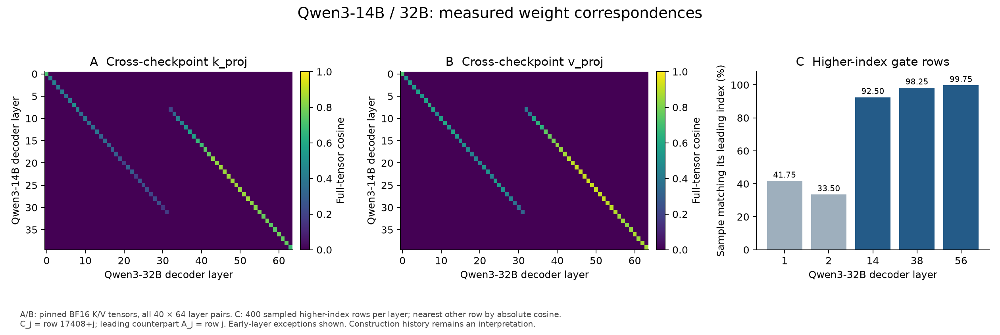

# Qwen3-14B/32B weight correspondences

Measured October 25; saved-table recomputation and selected cached-payload checks in a separate Codex-assisted session October 26.
Included in copy-blocks-qwen v0.2.0. All decoder indices are zero-based; auxiliary
multi-token-prediction (MTP) and vision layers are excluded.
See the [glossary](../../docs/GLOSSARY.md) and [column definitions](COLUMNS.md).

**The first 17,408 gate-neuron indices in Qwen3-32B show substantial correspondence
with the same indices in Qwen3-14B. The higher-index 8,192-channel segment also has a
structured relationship to the leading channels, with different results in early and later layers.**
This is consistent with a structured expansion interpretation. The measured artifacts
are two released checkpoints, not a record of how one was trained from the other.

## Two comparisons with different scopes

1. **Within Qwen3-32B:** the offset-24 correspondence extends to all three MLP projection
   families. Layers 8–31 are compared with 32–55. The all-pairs scan covers all 64 decoder layers.
2. **Between Qwen3-14B and Qwen3-32B:** directly compare matching-sized K/V tensors;
   compare the first 17,408 gate rows index for index; separately examine gate rows with indices 17,408–25,599 and group-aware query/output head correspondences.

The cross-checkpoint best-layer map is L→L for 14B layers 0–9 and L→L+24 for 10–39,
under both K and V. This **does not change the within-32B repeated range to 10–31**:
the original within-checkpoint comparison remains 8–31 ↔ 32–55.



## What was measured

| Within-32B MLP family | Mean full-tensor cosine, 24 corresponding pairs | Mean at the other 16 offset-24 pairs | Mean aligned-neuron cosine |
|---|---:|---:|---:|
| Gate | 0.220201 | 0.002487 | 0.209532 |
| Up/value | 0.206348 | -0.000026 | 0.200534 |
| Down | 0.229534 | 0.000008 | 0.223436 |

Offset 24 has the highest all-pairs mean for each family. Most aligned neurons have
modest cosine: only 0.19–0.52% exceed 0.5. A small nonzero tail exceeds 0.7
(109 gate, 27 up and 48 down observations, out of 614,400 per family).

Across checkpoints, the mean aligned gate-row cosine for the higher-index block
(32B layers 32–55) rises from 0.276
at 14B L8/32B L32 to 0.692 at L31/L55. The first 17,408 rows were compared with
same-index and shuffled-row baselines; this is not a claim that all 17,408 rows
were individually proven to be one another's nearest neighbor or that the weights are equal.

For rows with indices 17,408–25,599, C_j is 32B row 17408+j and A_j is row j, j=0…8191.
Nearest-other-row searches use 400 sampled C rows per listed layer:

| 32B layer | Mean aligned C_j/A_j cosine, all 8,192 rows | Sample whose nearest other 32B row is exactly A_j |
|---|---:|---:|
| 1 | 0.7883 | 41.75% |
| 2 | 0.8042 | 33.50% |
| 14 | 0.1808 | 92.50% |
| 38 | 0.2459 | 98.25% |
| 56 | 0.3236 | 99.75% |

The early layers are therefore shown explicitly. “All higher-index neurons are duplicates
of their index-matched leading neurons at every layer” is stronger than this experiment establishes.
The comparison to the 14B uses the listed mapped layers and the same 400-row sample;
full values and 14B-index match rates are in the measurement table.

Query/output heads were checked under key/value (KV) grouping in seven layer pairs per family.
Both models have eight KV groups: the 14B has five query heads per group and the
32B has eight. The slot pattern below lists, for each of the eight 32B heads in
a group, the index within that group of the best-matching 14B head.
All 896 tested 32B-head best matches are in the corresponding KV group;
890/896 follow the slot pattern `[0,1,2,0,1,2,3,4]`, with six exceptions retained.
This is a sampled head result, not an all-layer exact recipe.

## Corrections

The October 26 saved-vector recomputation corrected an earlier summary that
said no gate or up neuron-pair cosine exceeded 0.7: the retained vectors contain
109 gate and 27 up observations above 0.7 (and 48 down), out of 614,400 per family.
It also replaced a blanket 0.67–0.70 cross-checkpoint gate description with the
measured layer-dependent values, including 0.276 at L8/L32 and 0.692 at L31/L55.
[CORRECTIONS.md](CORRECTIONS.md) gives the affected reporting files and scopes;
the stored tensors and per-neuron vectors were not changed.

## Evidence and pins

- [Complete measurement tables A–D](WEIGHT_RESULTS.md), with original family and sample definitions.
- [Derived data](data/): 6,048 all-layer-pair MLP rows, 189 offset rows, saved per-neuron
  vectors, both 40×64 cross-checkpoint K/V matrices, 64 gate-row comparisons and head records.
- [Offline reducer](code/verify_and_plot.py): recomputes table/vector arithmetic and
  regenerates the summary and figure. It does not remeasure the underlying model bytes.
- [Saved-output and cached-payload check](audit/validation.json): includes seven distinct cached payloads (eight references)
  and BF16 gate/head spot checks. Up/down L14/L38 raw payloads were unavailable
  to that check; their saved-output reductions passed.
- Original scripts are retained under [code/as_run/](code/as_run/); portable copies are under
  [code/](code/), with [recorded path changes](audit/portable_changes.json).

| Checkpoint | Revision | Hidden width | MLP width | Decoder layers |
|---|---|---:|---:|---:|
| Qwen/Qwen3-14B | `40c069824f4251a91eefaf281ebe4c544efd3e18` | 5,120 | 17,408 | 40 |
| Qwen/Qwen3-32B | `9216db5781bf21249d130ec9da846c4624c16137` | 5,120 | 25,600 | 64 |

Payload hashes are in the per-family provenance and cross-checkpoint result files.
Aligned/shared-row and head cosines use float64 accumulation. The section-C maximum-absolute-cosine searches use 300 sampled rows; the C2
row searches use 400. These row searches use float32 normalization and matrix
products. The section-D head comparisons use float64 and all 64 target heads
at each of seven listed layer pairs per projection family.
Weights and response measurements are distinct: see [the separate Q8 response study](../qwen3_response/README.md).

## Reproduction

From the repository root, with the root requirements installed:

```bash
python studies/qwen3_weights/code/verify_and_plot.py --out reproduction/qwen3_weights_readout
```

Fresh byte-range remeasurement is CPU-only and needs substantial cache disk space.
Each 64-layer MLP family alone is about 16.8 GB of BF16 payloads; all three about
50.3 GB, with additional cross-checkpoint attention/gate/head payloads. These are
not included in the evidence download. Use an appropriately sized external cache:

```bash
python studies/qwen3_weights/code/scan_mlp_32b.py --family mlp.gate_proj.weight --cache /path/to/tensor-cache --out reproduction/qwen3_weights/gate_proj
python studies/qwen3_weights/code/scan_mlp_32b.py --family mlp.up_proj.weight --cache /path/to/tensor-cache --out reproduction/qwen3_weights/up_proj
python studies/qwen3_weights/code/scan_mlp_32b.py --family mlp.down_proj.weight --cache /path/to/tensor-cache --out reproduction/qwen3_weights/down_proj
```

The three `cross_*` commands below can download missing tensors. The final
`followup_from_cache.py` command uses the existing pinned cache and does not download.
Choose a new output directory:

```bash
export COPY_BLOCKS_TENSOR_CACHE=/path/to/tensor-cache
export COPY_BLOCKS_OUTPUT="$PWD/reproduction/qwen3_weights_cross"
python studies/qwen3_weights/code/cross_14b_32b_attn.py
python studies/qwen3_weights/code/cross_14b_32b_mlp.py
python studies/qwen3_weights/code/cross_14b_32b_heads.py
python studies/qwen3_weights/code/followup_from_cache.py
```
The query/output (Q/O) scanner checks free disk space before the O-projection scan;
check that both output families were produced before running the follow-up.
The Qwen3 scanners record payload hashes but do not automatically compare existing
cache files with the released payload hashes; an equal-length cache file can be
reused without that check. Compare regenerated payload hashes against the released
per-family and cross-checkpoint provenance before treating a new scan as a reproduction
of these inputs. This differs from the Qwen2.5 cache reproducer, which rejects a
payload-hash mismatch. The offline commands above check the fixed released arrays.
Do not point a remeasurement at the released `data/` directory.

Offline reductions check the packaged evidence. The portable scanners have syntax,
import, CLI and numerical-code checks; a fresh full tensor scan has not been repeated
with these portable copies.
